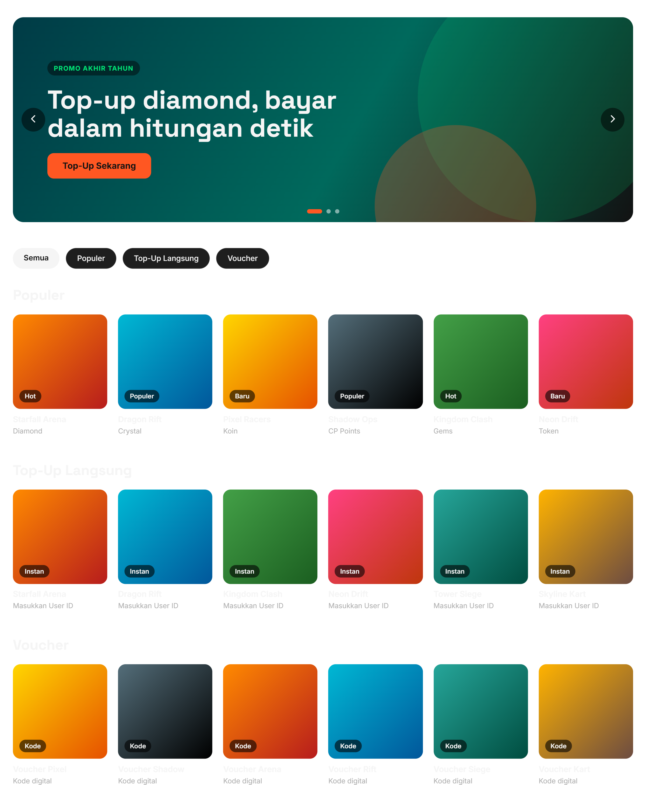
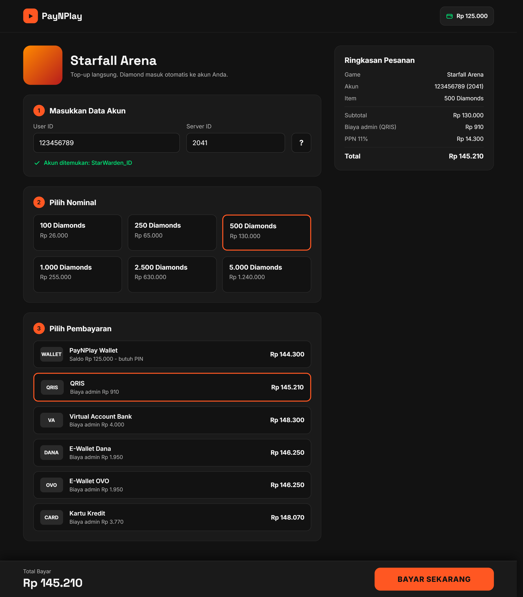
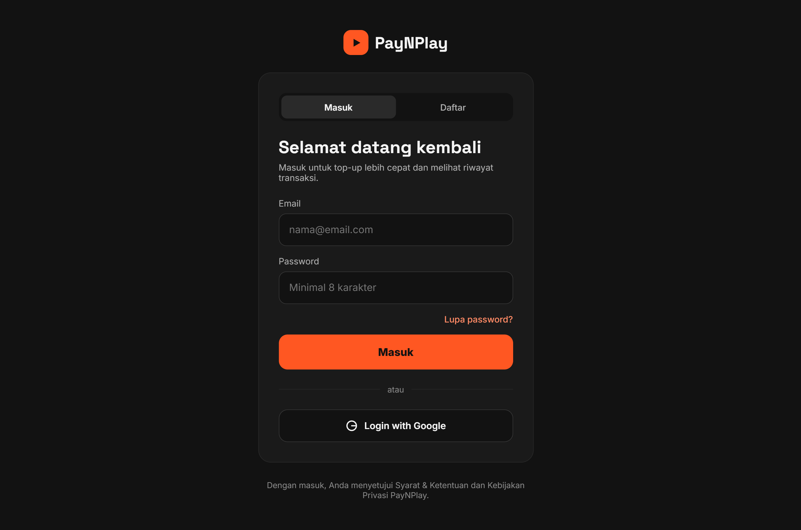
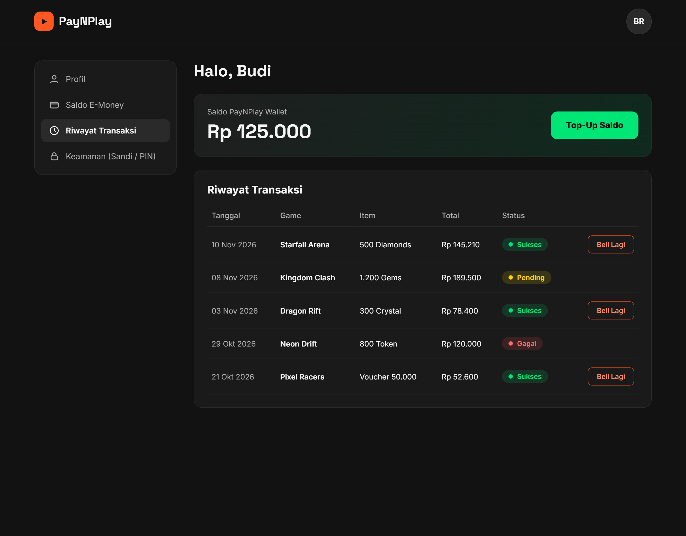

# Tugas Pemrograman Web Pertemuan 10

### Identitas
Nama    : Benedictus Imanuel Wicaksono 
NRP     : 5025251039 
Kelas   : Pemrograman Web B 

## 1. Nama Proyek

**PayNPlay** 

## 2. Deskripsi Proyek

PayNPlay adalah sebuah platform *e-commerce* berbasis web yang dikhususkan untuk pembelian kredit game (top-up), voucher digital, dan item in-game. Platform ini dirancang dengan antarmuka yang sederhana, cepat, dan berfokus pada konversi pengguna. Sistem ini mendukung dompet digital internal (E-money/PayNPlay Wallet) dan terintegrasi dengan Payment Gateway eksternal untuk menjamin keamanan dan fleksibilitas transaksi.

## 3. Tujuan Proyek

* Mempermudah transaksi dengan menyediakan proses checkout dalam hitungan detik bagi para gamer.

* Membangun platform yang aman untuk transaksi finansial mikro maupun makro.

* Menerapkan sistem dompet digital (E-money) dan riwayat transaksi untuk mendorong pembelian berulang.

* Mengarahkan fokus pengguna langsung ke proses penyelesaian pembayaran dengan UI yang bersih dan *CTA (Call to Action)* yang mencolok.

## 4. Ruang Lingkup Proyek 

### A. Pengelolaan Data

* **User Data:** Profil pengguna, saldo E-money, kredensial login terenkripsi.

* **Katalog Produk:** Data game, kategori (Voucher, Top-up Langsung), daftar nominal item, dan harga.

* **Data Transaksi:** Pencatatan *Order ID*, status pembayaran (Pending, Success, Failed), metode pembayaran, dan *timestamp*.

* **Database Relasional:** Menggunakan MySQL untuk menjaga integritas data finansial (ACID compliance).

### B. Logika Bisnis (Business Logic)

* Perhitungan otomatis subtotal, biaya admin dari metode pembayaran, dan total akhir.

* Logika pemotongan saldo internal jika pengguna memilih membayar dengan *PayNPlay Wallet*.

* Pengecekan keabsahan User ID/Zone ID game sebelum meneruskan transaksi.

* Pengurangan stok otomatis (jika berupa voucher fisik/kode) saat transaksi berhasil.

### C. Authentifikasi dan Security

* **Sistem Login & Register:** Menggunakan JWT (JSON Web Tokens) untuk manajemen sesi.

* **Keamanan Sandi:** Hashing *password* menggunakan bcrypt atau Argon2.

* **Proteksi Serangan:** Implementasi *Rate Limiting* (mencegah spam request/brute force) dan perlindungan CSRF/XSS.

* **Verifikasi E-money:** Autentikasi tambahan (PIN atau 2FA) saat melakukan pembayaran menggunakan saldo internal.

### D. Integrasi API (Application Programming Interface)

* **Payment Gateway:** Integrasi dengan pihak ketiga (misal: Midtrans, Xendit, atau Stripe) untuk menerima pembayaran via QRIS, Virtual Account, E-Wallet (OVO, Dana), dan Kartu Kredit.

* **Game Publisher API (Opsional/Mock):** API untuk menyuntikkan (inject) diamond/item langsung ke akun pengguna berdasarkan User ID.

## 5. Fitur Utama

1. **Sistem Akun (Auth):** Sign In, Sign Up, Lupa Password.

2. **Katalog & Pencarian:** Menampilkan daftar game populer, filter berdasarkan kategori.

3. **Sistem Pembayaran Dinamis:** Pemilihan nominal dan metode pembayaran dalam satu halaman.

4. **PayNPlay Wallet (E-Money):** Sistem deposit (top-up saldo akun) dan pembayaran cepat via saldo akun.

5. **Riwayat Transaksi (History):** Tabel *tracking* pembelian lengkap dengan fitur "Beli Lagi" (Re-order).

## 6. Detail Desain UI/UX per Page

### A. Halaman Utama (Homepage)

* **Header:** Logo di kiri, Search bar di tengah, tombol Sign In/Profil & Saldo E-Money di kanan.

* **Hero Banner:** *Carousel* gambar game promo terbaru (ukuran *widescreen*, desain *clean* tanpa teks berlebihan).

* **Grid Katalog Game:**

  * Kartu (Card) game berbentuk kotak dengan efek *hover* (sedikit membesar dan bayangan tajam).

  * Dikelompokkan berdasarkan kategori: "Populer", "Top-Up Langsung", "Voucher".

  * Background halaman abu-abu sangat gelap, sehingga poster game terlihat *pop-out* dan berwarna.

### B. Halaman Detail Pembelian (Top-Up Page)

* **Section 1 Masukkan Data Akun.** Form input simpel untuk "User ID" dan "Server ID" dengan tombol bantuan "?" yang memunculkan pop-up gambar cara mencari ID.

* **Section 2 Pilih Nominal.** Grid kotak-kotak berisi nominal (misal: 100 Diamonds, 500 Diamonds). Jika diklik, kotak akan memiliki *border* tebal berwarna *Vibrant Orange*.

* **Section 3 Pilih Pembayaran.** Desain akordion atau list. Menampilkan logo bank/E-wallet, harga akhir (termasuk admin), dan badge E-Money pengguna.

* **Sticky Checkout Bar.** Di bagian bawah layar (mengambang), terdapat bar yang menampilkan "Total Bayar" dan tombol besar berwarna **Vibrant Orange** bertuliskan **"BAYAR SEKARANG"**. Secara psikologis, warna mencolok dan posisi *sticky* mempercepat pengambilan keputusan pengguna.

### C. Halaman Autentikasi (Login/Register)

* Desain pop-up atau halaman khusus yang sangat minimalis.

* Hanya berisi form Email, Password, dan tombol Login besar. Tersedia opsi "Login with Google" untuk mempercepat proses masuk (mengurangi gesekan/friksi pengguna).

### D. Halaman Profil & Riwayat (Dashboard)

* **Sidebar:** Menu Profil, Saldo E-Money, Riwayat Transaksi, Keamanan (Ubah Sandi/PIN).

* **Kartu Saldo E-Money:** Kotak menampilkan saldo saat ini dengan tombol "Top-Up Saldo" berwarna hijau.

* **Tabel Riwayat:**

  * Menampilkan Tanggal, Nama Game, Item, Total Harga, dan Status.

  * Indikator warna status: Sukses (Hijau), Pending (Kuning), Gagal (Merah).

  * Terdapat tombol kecil "Beli Lagi" di setiap baris transaksi sukses.

## 7. Rencana Implementasi & Tech Stack

* **Front End:** html, css, bootstrap, js, (semuanya dalam .php dengan desain responsif).

* **Back End:** php dengan xampp

* **Database:** mysql

* **Lainnya:** Redis (untuk *caching* katalog game).

## Catatan
Source code yang ada disini masih dalam tahap pengembangan, mengingat tugas latihannya hanya diminta mendesain frontend dan backend nya saja
